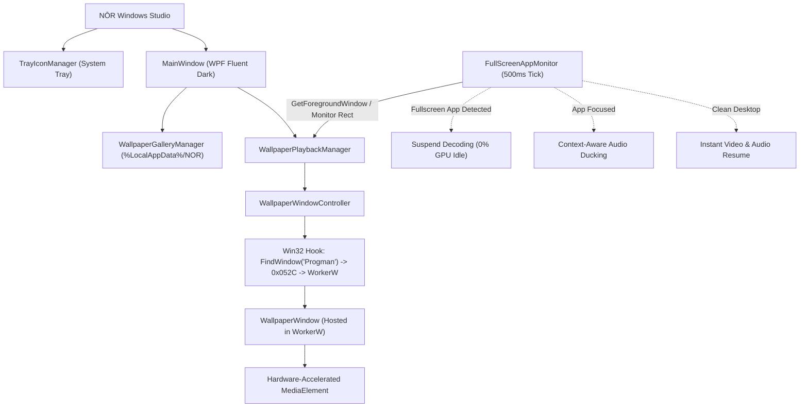

# NŌR for Windows 🪟

### Modern, Hardware-Accelerated Dynamic Live Wallpaper Engine for Windows 10 & 11

NŌR for Windows is a native, lightweight live wallpaper engine written in **C# (.NET 8)** and **WPF**, featuring zero-copy hardware video decoding, zero-drain fullscreen suspension, and context-aware audio ducking.

---

## 🌟 Architecture & Windows Desktop Integration



---

## ⚡ Key Features

* **Desktop Icon Transparency**: Injects directly into Windows Explorer's `WorkerW` canvas layer behind `SHELLDLL_DefView`, ensuring desktop icons, selection boxes, and right-click menus function normally with zero click-interception.
* **Zero-Drain Full-Screen Suspension**: Automatically monitors the foreground window. When any fullscreen game, video, or presentation is active, NŌR pauses video decoding to achieve **0% GPU & CPU idle usage**.
* **Context-Aware Audio Ducking**: Plays ambient wallpaper sound only when you are admiring your clean desktop. When you open any application window (browser, code editor, office app), sound is automatically muted.
* **System Tray Companion**: Minimizes to the Windows Notification Area. Control playback, mute sound, toggle fullscreen suspension, or access settings with a single right-click.
* **Precision Trimmer & Aspect Cropper**: Built-in dialogs to trim loop points and crop video scaling for 16:9, 16:10, or 21:9 ultrawide displays.
* **Launch on Startup**: Optional registry persistence to automatically boot with Windows in minimized tray mode.

---

## 🔨 Building `NOR.exe` from Source

### Prerequisites
* Windows 10 (1809+) or Windows 11
* [.NET 8 SDK](https://dotnet.microsoft.com/download/dotnet/8.0) or later

### One-Click Build
Run the provided batch script or PowerShell script:
```cmd
build.bat
```
or
```powershell
.\build.ps1
```

### Manual CLI Build
To compile a standalone, single-file `.exe` that includes all dependencies:
```bash
dotnet publish NOR.csproj -c Release -r win-x64 --self-contained true -p:PublishSingleFile=true -p:IncludeNativeLibrariesForSelfExtract=true -o ../release/win-x64
```
The output executable will be created at:
```
release/win-x64/NOR.exe
```

### Visual Studio 2022
1. Open `NOR.sln` in Visual Studio 2022.
2. Select **Release** and **x64**.
3. Press **F5** to run or **Build > Publish Selection** to output a single `.exe`.

---

## 📂 Project Structure

```
Win/
├── NOR.sln                  # Visual Studio 2022 Solution
├── NOR.csproj               # .NET 8 WPF Project Configuration
├── App.xaml / App.xaml.cs   # Application Entry & Minimized Mode
├── MainWindow.xaml (.cs)    # Dark-themed Fluent Studio Interface
├── Interop/
│   └── Win32.cs             # Win32 WorkerW hook & Fullscreen detection
├── Models/
│   ├── GalleryItem.cs       # Wallpaper metadata and duration models
│   └── AppSettings.cs       # Persistent user preferences
├── Services/
│   ├── WallpaperWindow.xaml # Canvas window attached to WorkerW
│   ├── WallpaperWindowController.cs
│   ├── WallpaperPlaybackManager.cs
│   ├── WallpaperGalleryManager.cs
│   ├── FullScreenAppMonitor.cs
│   ├── StartupManager.cs
│   └── TrayIconManager.cs
├── Views/
│   ├── VideoTrimDialog.xaml (.cs)
│   └── VideoCropDialog.xaml (.cs)
├── Assets/
│   ├── app.ico              # Multi-resolution application icon
│   ├── tray.ico             # System tray icon
│   └── logo.png
├── build.bat                # One-click Windows build script
└── build.ps1                # PowerShell build script
```

